# Innovating Product Development with 3D Printing and Additive Manufacturing — Learner Guide

**WSQ Course Code:** TGS-2022017597  |  **Conducted by:** Tertiary Infotech Academy Pte Ltd (UEN 201200696W)  |  **Version v8.1 · 22 August 2026**

## Contents

- [Introduction](#introduction)
- [Course Learning Outcomes](#course-learning-outcomes)
- [Before You Start — Environment Setup](#before-you-start--environment-setup)
- [Topic 01 — Overview of Additive Manufacturing and 3D Scanning](#topic-01--overview-of-additive-manufacturing-and-3d-scanning)
  - [Lab 1 — Extrude — Personalised Keychain Token](#lab-1--extrude--personalised-keychain-token)
  - [Lab 2 — Sweep — Giant Paper Clip Bookmark](#lab-2--sweep--giant-paper-clip-bookmark)
  - [Lab 3 — Loft — Mini Plant Pot with Custom Rails](#lab-3--loft--mini-plant-pot-with-custom-rails)
  - [Lab 4 — Revolve — Funnel from a 2D Profile](#lab-4--revolve--funnel-from-a-2d-profile)
  - [Lab 5 — Tolerance — Container and Lid (0.2 mm Fit)](#lab-5--tolerance--container-and-lid-02-mm-fit)
  - [Lab 6 — 3D Scan and Print a Real Object](#lab-6--3d-scan-and-print-a-real-object)
- [Topic 02 — Process Related Issues for AM](#topic-02--process-related-issues-for-am)
  - [Lab 7 — Install Cura and Slice Your First Model](#lab-7--install-cura-and-slice-your-first-model)
  - [Lab 8 — Bed Adhesion — Skirt vs Brim vs Raft](#lab-8--bed-adhesion--skirt-vs-brim-vs-raft)
  - [Lab 9 — Support Structures for Overhangs](#lab-9--support-structures-for-overhangs)
  - [Lab 10 — Filament Diagnostics — Diameter, Temperature and Flow](#lab-10--filament-diagnostics--diameter-temperature-and-flow)
- [Topic 03 — Process Improvement for AM](#topic-03--process-improvement-for-am)
  - [Lab 11 — Perimeters and Infill — Strength vs Speed](#lab-11--perimeters-and-infill--strength-vs-speed)
  - [Lab 12 — Infill Patterns — Zigzag vs Grid Strength Test](#lab-12--infill-patterns--zigzag-vs-grid-strength-test)
  - [Lab 13 — Layer Height and Top Thickness — Surface Quality](#lab-13--layer-height-and-top-thickness--surface-quality)
  - [Lab 14 — Ironing — Glass-Smooth Top Surfaces](#lab-14--ironing--glass-smooth-top-surfaces)
  - [Lab 15 — Fuzzy Skin — Textured Walls on a Vase](#lab-15--fuzzy-skin--textured-walls-on-a-vase)
  - [Lab 16 — Post-Processing — Support Removal and Sanding](#lab-16--post-processing--support-removal-and-sanding)
- [Revision — What to Master for the Assessment](#revision--what-to-master-for-the-assessment)
- [Glossary](#glossary)


## Introduction

This Learner Guide accompanies the WSQ course Innovating Product Development with 3D Printing and Additive Manufacturing (TGS-2022017597), conducted by Tertiary Infotech Academy Pte Ltd. It provides step-by-step instructions for all 16 hands-on labs, organised by the three course topics, and supports the TSC Additive Manufacturing (PRE-OPR-4012-1.1).

Use this guide alongside the course slides and the per-lab folders in labs/ of the course repository. Each lab folder carries this guide's steps plus any sample model files (STL) the lab needs. The written and practical assessments are open book — bring this guide.


## Course Learning Outcomes

- LO1: Analyze the AM and evaluate the use of reverse engineering using 3D scanning
- LO2: Analyze the issues and determine the requirements for AM processes
- LO3: Apply AM optimization techniques and assess the impact of process improvement

**TSC coverage**

- A1: Analyse and determine material considerations of components to be manufactured
- A2: Analyse process-related issues for using DMLS, SLS, SLM, powder bed and inkjet head, and/or 3D printing for AM
- A3: Determine processes and procedures for manufacturing metallic and non-metallic components using AM
- A4: Evaluate use of reverse engineering processes for components through 3D scanning and subsequent AM
- A5: Apply optimisation techniques to improve efficiency of AM processes and product quality
- A6: Assess the impact of manufacturing process improvements on business operations

- K1: AM characteristics, techniques and systems
- K2: Requirements of different AM processes
- K3: Factors to be considered when selecting AM solutions
- K4: Impact of AM on manufacturing operations
- K5: Methods for reviewing AM performance
- K6: Benefits and trade-offs of AM
- K7: Methods of ensuring long-term sustainability of AM


## Before You Start — Environment Setup

**What you need**

- A computer with Autodesk Fusion 360 installed — the free personal-use or education licence is sufficient (https://www.autodesk.com/products/fusion-360).
- Ultimaker Cura slicing software — free from https://ultimaker.com/software/ultimaker-cura (installed in Lab 7; install early if you want a head start).
- An FDM 3D printer with PLA filament (provided in class), plus digital calipers, pliers and sandpaper (120–400 grit) for the tolerance and post-processing labs.
- A smartphone with a 3D-scanning app for Lab 6 — Polycam or Kiri Engine (Android/iOS), or Scandy Pro / Heges on LiDAR iPhones/iPads.
- The sample and diagnostic models in each labs/ folder, including calibration cubes, support/orientation benchmarks, retraction and cooling tests, wall-line tests, optimisation variants and finishing parts.

**Fusion 360 quick orientation**

- Sketch-driven CAD: draw 2D profiles on sketch planes, then turn them 3D with Extrude, Revolve, Sweep and Loft.
- The browser (left panel) lists bodies, sketches and construction planes; the timeline (bottom) records every operation for editing.
- Export any body for printing via File ▸ Export ▸ STL, or right-click the body ▸ Save As Mesh.

**Conventions used in every lab**

- Menu paths are written as Tool ▸ Menu ▸ Command (e.g. Create ▸ Extrude).
- Values shown (dimensions, temperatures, percentages) are tested starting points — your printer may need small adjustments.
- Every lab ends with a 'Test it' check — do not move on until it passes.
- Safety: hot nozzles (200 °C+), moving axes and sharp tools — keep hands clear while printing and use pliers for support removal.


## Topic 01 — Overview of Additive Manufacturing and 3D Scanning

AM systems · material considerations · benefits & trade-offs · 3D scanning and reverse engineering  (K1, K3, K6 · A1, A4)

**Key concepts**

- Additive manufacturing — Builds parts layer by layer directly from a CAD file — no part-specific tools, dies or molds.
- Seven process families — Material extrusion, vat photopolymerisation, powder bed fusion, material jetting, binder jetting, directed energy deposition, sheet lamination.
- Material considerations — Mechanical/thermal properties, design complexity, volume, post-processing and cost drive the choice of AM solution.
- Benefits & trade-offs — Design freedom, rapid prototyping and low-waste versus slower throughput, material limits and post-processing.
- 3D scanning — Captures real-world geometry so worn or legacy parts can be reverse-engineered into CAD and re-manufactured with AM.
- Design for AM — Fusion 360 extrude, sweep, loft and revolve; stress concentration and tolerance-aware design.


### Lab 1 — Extrude — Personalised Keychain Token

TSC objective: A1 — determine material and design considerations while modelling a printable part with the extrude technique.

Goal: Model an elliptical keychain token in Fusion 360, personalise it with the first letter of your name, then slice it in Cura and 3D print it.

**What you'll build**

A personalised elliptical keychain token, sliced and 3D printed in PLA.   (Tools: Fusion 360, Ultimaker Cura, FDM printer (PLA).)

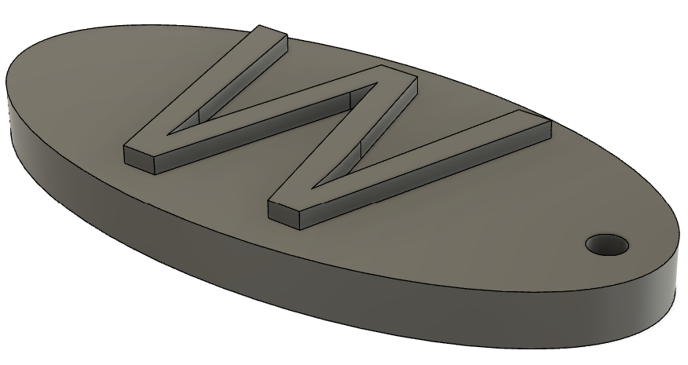

*Lab 1 reference — target model / setting*

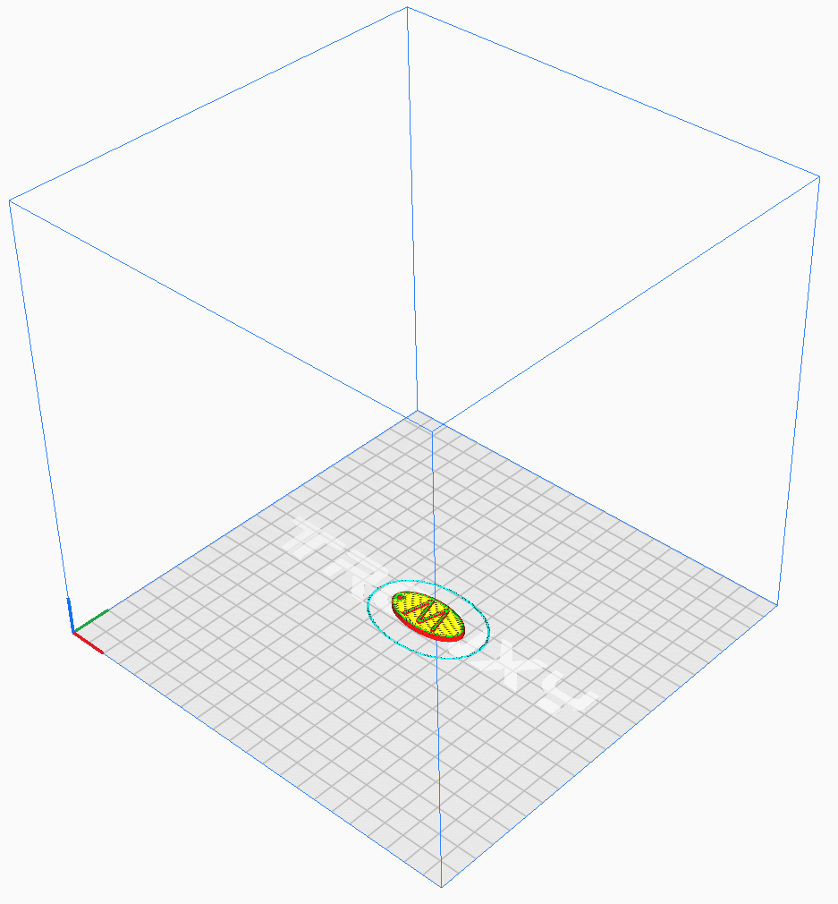

*Lab 1 reference — as prepared in the tool*

**Step-by-step**

1. Create a new design in Fusion 360 and start a sketch on the XY plane.

   ```
   Fusion 360 ▸ File ▸ New Design ▸ Create Sketch ▸ XY plane
   ```

2. Draw an ellipse about the origin — approximately 50 mm long and 30 mm wide.

   ```
   Sketch ▸ Ellipse — major 50 mm, minor 30 mm
   ```

3. Add a 4 mm circle near one end of the ellipse for the keyring hole, then finish the sketch.

   ```
   Sketch ▸ Circle — Ø 4 mm ▸ Finish Sketch
   ```

4. Extrude the ellipse profile (excluding the circle) to 3 mm to form the token body.

   ```
   Create ▸ Extrude — profile: ellipse, distance 3 mm
   ```

5. Sketch the first letter of your name on the token's top face and extrude it 1 mm.

   ```
   Create Sketch ▸ Text — height 18 mm ▸ Extrude 1 mm (Join)
   ```

6. Export the body as an STL mesh for slicing.

   ```
   File ▸ Export ▸ STL  (or Utilities ▸ Make ▸ 3D Print)
   ```

7. Open the STL in Cura, keep the flat face on the build plate, and slice with the default 0.2 mm profile.

   ```
   Cura ▸ Open File ▸ token.stl ▸ Slice
   ```

8. Save the G-code and print the token; remove it from the bed once cooled.

   ```
   Cura ▸ Save to Disk ▸ print
   ```


**Evidence to capture**

- Fusion 360 screenshot showing the ellipse, 4 mm keyring hole and raised initial.
- Cura Preview screenshot confirming flat orientation and no supports.
- Photo or inspection note confirming the printed initial and clear keyring hole.

**Test it**

The sliced preview shows the token printing flat with no supports; the printed token carries your raised letter and the keyring hole is clear.

> **Note:** This lab lives in labs/lab-01-extrude-personalised-keychain-token/ together with any sample files it needs.

---


### Lab 2 — Sweep — Giant Paper Clip Bookmark

TSC objective: A1 — apply the sweep technique to produce a printable path-driven part.

Goal: Model a giant paper clip bookmark in Fusion 360 by sweeping a circular profile along a paper-clip path, then slice and 3D print it.

**What you'll build**

A giant paper clip bookmark modelled with the sweep technique and 3D printed flat.   (Tools: Fusion 360, Ultimaker Cura, FDM printer (PLA).)

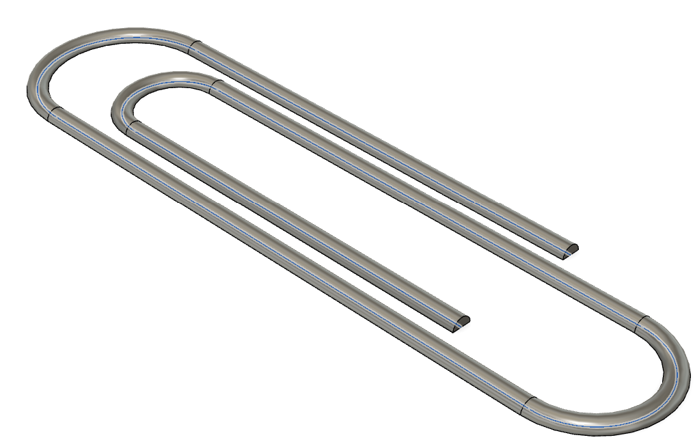

*Lab 2 reference — target model / setting*

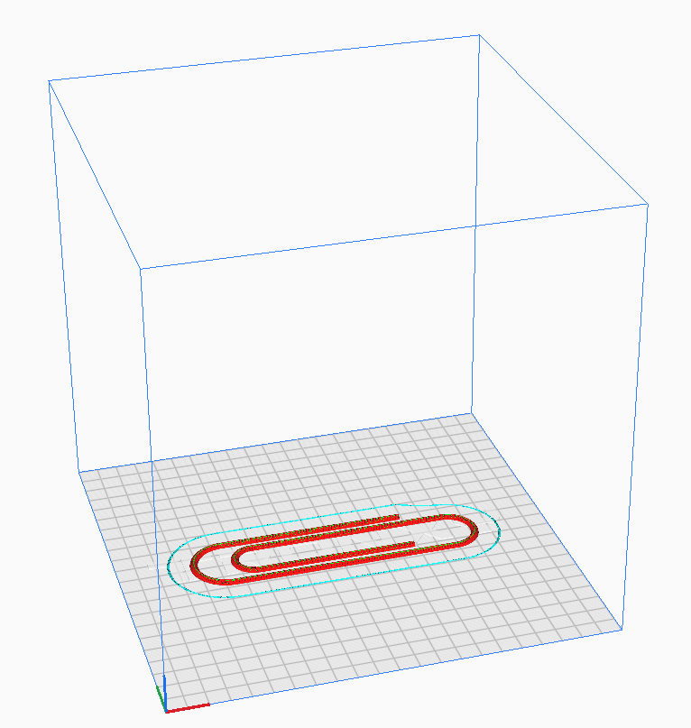

*Lab 2 reference — as prepared in the tool*

**Step-by-step**

1. Start a sketch on the XY plane and draw the paper-clip path — three nested U-turns — using the Line and Arc tools.

   ```
   Create Sketch ▸ Line + Arc (3-point) — overall ~90 × 35 mm
   ```

2. Add fillets so every corner of the path is a smooth arc, then finish the sketch.

   ```
   Sketch ▸ Fillet — radius 5 mm ▸ Finish Sketch
   ```

3. Create a plane perpendicular to one end of the path and sketch a 2.5 mm circle on it.

   ```
   Construct ▸ Plane Along Path (t=0) ▸ Sketch ▸ Circle Ø 2.5 mm
   ```

4. Sweep the circle along the path to form the solid clip.

   ```
   Create ▸ Sweep — profile: circle, path: clip sketch
   ```

5. Export the body as an STL file.

   ```
   File ▸ Export ▸ STL
   ```

6. Open it in Cura and lay the clip flat on the build plate so no supports are needed.

   ```
   Cura ▸ Open File ▸ clip.stl ▸ Rotate — flat
   ```

7. Slice with a 0.2 mm profile and print.

   ```
   Cura ▸ Slice ▸ Save to Disk ▸ print
   ```


**Evidence to capture**

- Fusion 360 screenshot showing the path, perpendicular profile and completed sweep.
- Cura Preview screenshot confirming full build-plate contact and no supports.
- Photo or inspection note showing that the printed clip flexes and grips pages.

**Test it**

The preview shows the whole clip printing in contact with the bed; the printed clip flexes slightly and grips a few pages like a real paper clip.

> **Note:** This lab lives in labs/lab-02-sweep-giant-paper-clip/ together with any sample files it needs.

---


### Lab 3 — Loft — Mini Plant Pot with Custom Rails

TSC objective: A1 — apply the loft technique with guide rails to create a freeform printable vessel.

Goal: Model a mini plant pot in Fusion 360 by lofting between a square top and a circular base with custom guide rails, then slice and 3D print it.

**What you'll build**

A mini plant pot lofted from circle to square, 3D printed without supports.   (Tools: Fusion 360, Ultimaker Cura, FDM printer (PLA).)

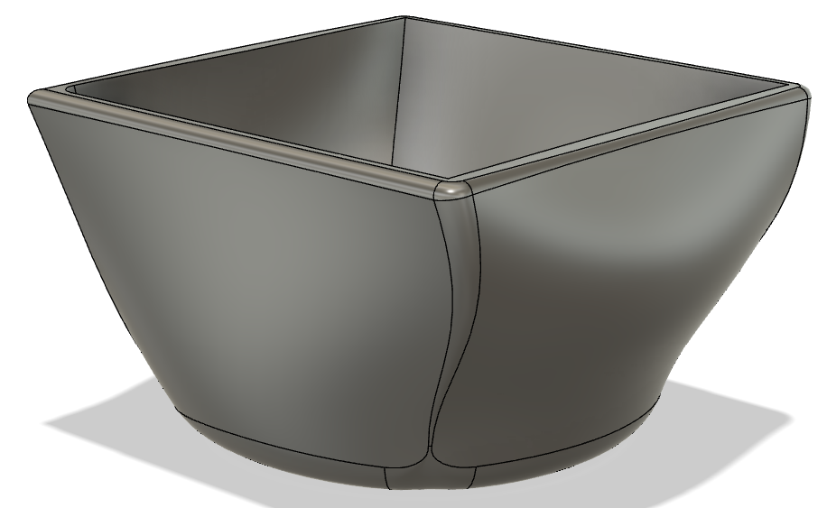

*Lab 3 reference — target model / setting*

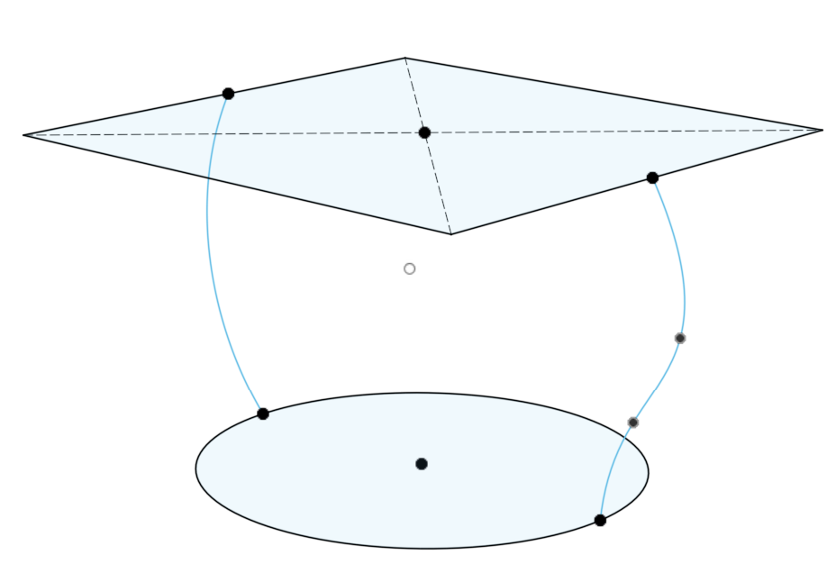

*Lab 3 reference — as prepared in the tool*

**Step-by-step**

1. Sketch a 50 mm circle on the XY plane — this is the pot base.

   ```
   Create Sketch ▸ Circle — Ø 50 mm ▸ Finish Sketch
   ```

2. Create an offset plane 60 mm above the base and sketch a 60 mm square on it.

   ```
   Construct ▸ Offset Plane — 60 mm ▸ Sketch ▸ Rectangle 60 × 60 mm
   ```

3. Loft from the circle to the square; add guide rails between matching points to control the curve.

   ```
   Create ▸ Loft — profiles: circle + square, rails: optional splines
   ```

4. Shell the solid to a 2.5 mm wall, removing the top face, to hollow the pot.

   ```
   Modify ▸ Shell — face: top, thickness 2.5 mm
   ```

5. Export the pot as an STL file.

   ```
   File ▸ Export ▸ STL
   ```

6. Slice in Cura standing base-down; no supports are needed because the walls flare outward.

   ```
   Cura ▸ Open File ▸ pot.stl ▸ Slice
   ```

7. Print the pot and inspect the loft surface finish.

   ```
   Cura ▸ Save to Disk ▸ print
   ```


**Evidence to capture**

- Fusion 360 screenshot showing both loft profiles, guide rails and the 2.5 mm shell.
- Cura Preview screenshot confirming base-down, support-free orientation.
- Photo or inspection note on wall continuity and the circle-to-square transition.

**Test it**

The pot prints support-free with an even 2.5 mm wall; the loft transition from circle to square is smooth with no layer separation.

> **Note:** This lab lives in labs/lab-03-loft-mini-plant-pot/ together with any sample files it needs.

---


### Lab 4 — Revolve — Funnel from a 2D Profile

TSC objective: A1 — apply the revolve technique and choose a print orientation that avoids supports.

Goal: Model a funnel in Fusion 360 by sketching its half cross-section and revolving it about the vertical axis, then invert it in Cura and 3D print it.

**What you'll build**

A working funnel revolved from a single 2D profile, printed wide-end down.   (Tools: Fusion 360, Ultimaker Cura, FDM printer (PLA).)

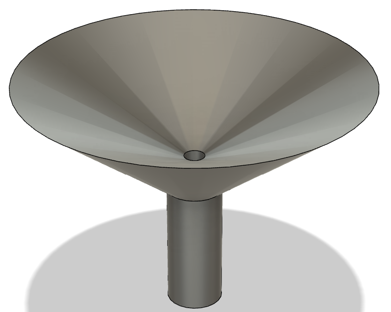

*Lab 4 reference — target model / setting*

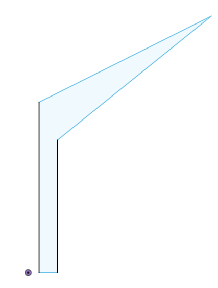

*Lab 4 reference — as prepared in the tool*

**Step-by-step**

1. Sketch the funnel's half profile on the XZ plane: a wide cone tapering into a narrow spout, drawn as a closed outline 2 mm thick.

   ```
   Create Sketch ▸ Line — cone Ø 60 mm → spout Ø 8 mm, wall 2 mm
   ```

2. Revolve the profile 360° around the vertical (Z) axis to form the funnel body.

   ```
   Create ▸ Revolve — profile: half section, axis: Z, angle 360°
   ```

3. Check the wall is watertight and uniform using the Inspect ▸ Section Analysis tool.

   ```
   Inspect ▸ Section Analysis
   ```

4. Export the funnel as an STL file.

   ```
   File ▸ Export ▸ STL
   ```

5. Open it in Cura — it imports spout-up; rotate it so the wide mouth sits on the build plate.

   ```
   Cura ▸ Rotate — 180° about X (wide end down)
   ```

6. Slice and confirm the cone angle prints without supports, then print.

   ```
   Cura ▸ Slice ▸ Preview ▸ Save to Disk
   ```


**Evidence to capture**

- Fusion 360 screenshot showing the closed half-profile and 360-degree revolve.
- Cura Preview screenshot confirming wide-end-down orientation and no supports.
- Photo or water-flow note confirming a clear, functional spout.

**Test it**

Sliced upside-down the funnel needs no supports; water poured into the printed funnel flows cleanly through the spout.

> **Note:** This lab lives in labs/lab-04-revolve-funnel-from-a/ together with any sample files it needs.

---


### Lab 5 — Tolerance — Container and Lid (0.2 mm Fit)

TSC objective: A1 — determine digital and physical tolerances between assembling parts.

Goal: Model a container and lid as two separate bodies in Fusion 360 with a 0.2 mm clearance, verify the digital tolerance, then 3D print and test the physical fit.

**What you'll build**

A two-part container whose lid slides on with a designed 0.2 mm clearance.   (Tools: Fusion 360, Ultimaker Cura, FDM printer (PLA), digital calipers, supplied FDM Box reference files.)

**Supplied model files**

- FDM-Box-Final.f3d — Editable Fusion 360 reference model for design-history and clearance inspection.
- FDM-Box-Final.stl — Printable mesh for orientation, scale and fit comparison.
- FDM-Box-Cura.3mf — Cura project retaining the supplied slicer setup for comparison with your own profile.

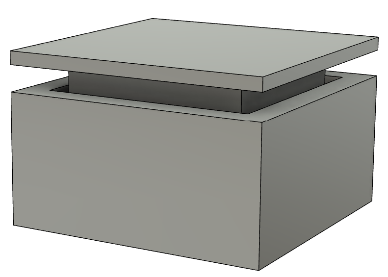

*Lab 5 reference — target model / setting*

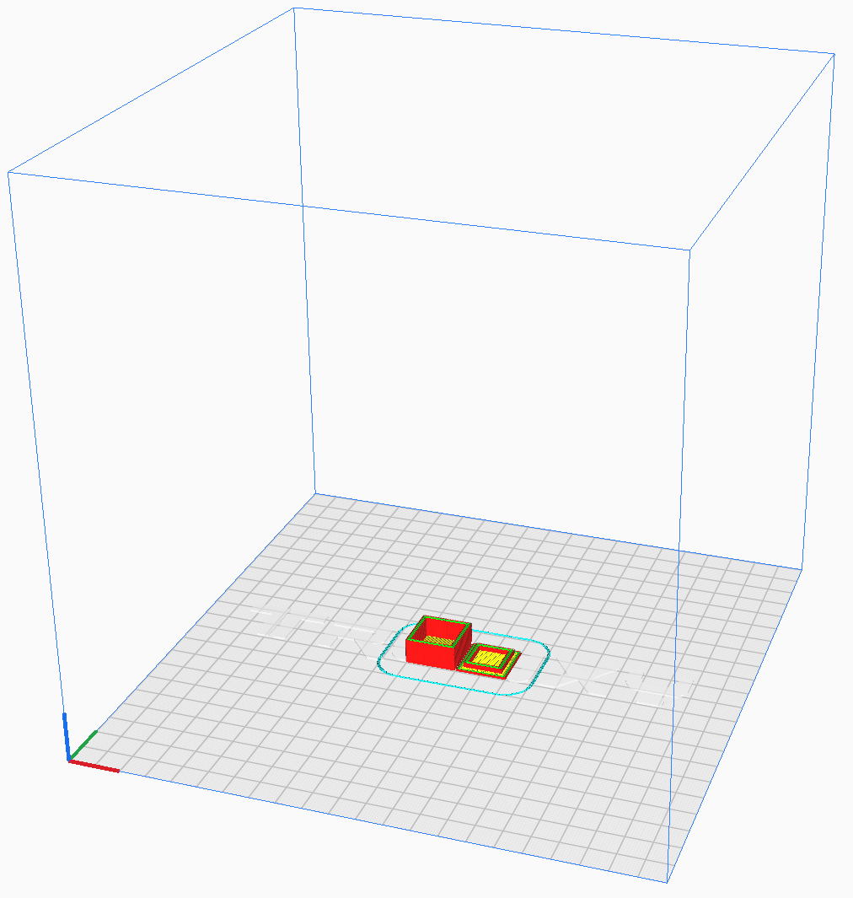

*Lab 5 reference — as prepared in the tool*

**Step-by-step**

1. Model a 50 × 50 × 30 mm box and shell it to 2 mm walls with the top face removed.

   ```
   Create ▸ Box 50×50×30 ▸ Modify ▸ Shell — 2 mm
   ```

2. Model the lid as a second body: a 54 × 54 × 6 mm cap whose inner skirt is offset 0.2 mm from the box's outer wall.

   ```
   Create ▸ Box (New Body) ▸ Modify ▸ Offset Faces — 0.2 mm clearance
   ```

3. Measure the designed gap with the Inspect ▸ Measure tool to confirm 0.2 mm per side.

   ```
   Inspect ▸ Measure — wall-to-skirt gap = 0.2 mm
   ```

4. Export each body as its own STL file.

   ```
   Right-click body ▸ Save As Mesh — container.stl, lid.stl
   ```

5. In Cura, print the container open-end up; rotate the lid open-end up as well (invert it).

   ```
   Cura ▸ Open Files ▸ Rotate lid 180°
   ```

6. Slice and print both parts in one job.

   ```
   Cura ▸ Slice ▸ Save to Disk ▸ print
   ```

7. Measure the printed gap with digital calipers and test the fit.

   ```
   Calipers: outer wall vs lid skirt — expect ≈0.2 mm/side
   ```

8. Open FDM-Box-Final.f3d as a read-only reference and inspect how its bodies, wall thickness and clearances are organised; do not replace your own design with it.

   ```
   Fusion 360 ▸ File ▸ Open ▸ FDM-Box-Final.f3d ▸ Inspect ▸ Measure
   ```

9. Open FDM-Box-Cura.3mf and compare its saved orientation and slicer settings with your own job; record one setting you would retain and one you would change for your printer.

   ```
   Cura ▸ File ▸ Open Project ▸ FDM-Box-Cura.3mf
   ```


**Evidence to capture**

- Screenshot of the 0.2 mm designed clearance measured in Fusion 360.
- Cura comparison showing your model and FDM-Box-Final.stl at the intended scale and orientation.
- Caliper readings and a short pass/fail note for the printed lid fit.

**Test it**

The lid slides onto the container with light friction — neither loose nor forced — and your evidence distinguishes the designed 0.2 mm clearance, the measured printed result and the supplied FDM Box reference setup.

> **Note:** This lab lives in labs/lab-05-tolerance-container-and-lid/ together with any sample files it needs.

---


### Lab 6 — 3D Scan and Print a Real Object

TSC objective: A4 — evaluate reverse engineering of a component through 3D scanning and subsequent AM.

Goal: Scan a real object with a mobile 3D-scanning app, export the mesh as an STL file, repair it if needed, then slice and 3D print the reproduction.

**What you'll build**

A 3D-printed reproduction of a real object captured by photogrammetry on your phone.   (Tools: Polycam / Kiri Engine / Scandy Pro (mobile), Fusion 360, Ultimaker Cura.)

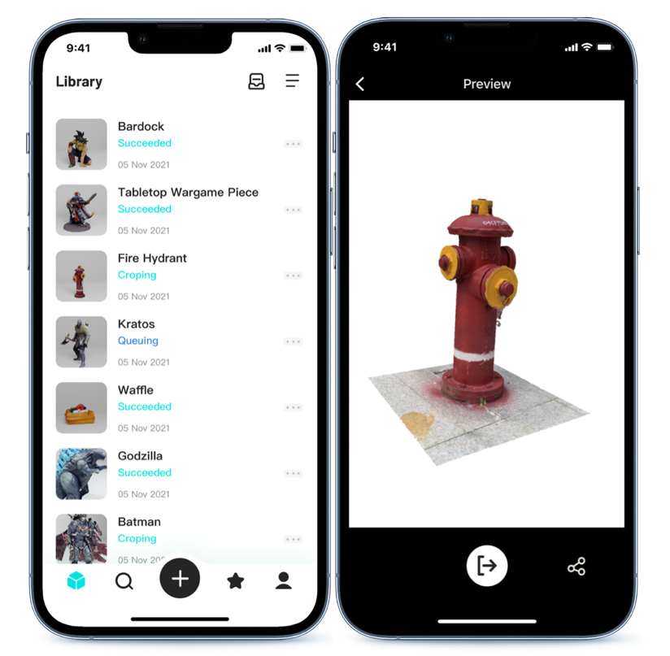

*Lab 6 reference — target model / setting*

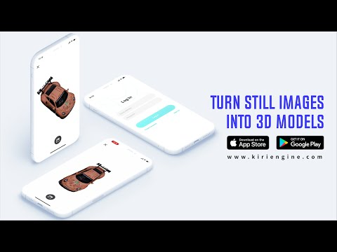

*Lab 6 reference — as prepared in the tool*

**Step-by-step**

1. Install a 3D scanning app on your phone — Polycam or Kiri Engine (Android/iOS), or Scandy Pro / Heges (iOS LiDAR).

   ```
   App Store / Google Play ▸ Polycam or Kiri Engine
   ```

2. Pick a matte, textured object about the size of a mug and place it on a contrasting background with even lighting.

   ```
   Object: non-shiny, non-transparent, stable
   ```

3. Capture 30–60 photos in two orbits around the object — one at eye level, one from above — keeping it centred.

   ```
   App ▸ Photo mode ▸ capture 2 full orbits
   ```

4. Let the app reconstruct the mesh, then crop away the background and floor plane.

   ```
   App ▸ Process ▸ Crop / Remove floor
   ```

5. Export the model as an STL (or OBJ, then convert via Fusion 360's Mesh workspace).

   ```
   App ▸ Export ▸ STL
   ```

6. Repair holes or stray triangles: Fusion 360 ▸ Mesh ▸ Repair, or import directly into Cura if clean.

   ```
   Fusion 360 ▸ Mesh ▸ Repair ▸ Export STL
   ```

7. Scale the model in Cura to a 20-minute print size (~40 mm tall), slice with supports if needed, and print.

   ```
   Cura ▸ Scale 40 mm ▸ Slice ▸ print
   ```


**Evidence to capture**

- Screenshot of the cleaned scan with the floor/background removed.
- Mesh-repair evidence showing a watertight model that loads cleanly in Cura.
- Photo comparing the source object with the recognisable scaled print.

**Test it**

The exported STL loads into Cura as a watertight mesh, and the printed part is a recognisable scaled reproduction of the scanned object.

> **Note:** This lab lives in labs/lab-06-3d-scan-and-print/ together with any sample files it needs.

---


## Topic 02 — Process Related Issues for AM

Printer hardware · slicing · adhesion · extrusion · temperature · materials  (K2, K4 · A2, A3)

**Key concepts**

- Five issue sources — Printer hardware, materials, printing process conditions, environment conditions and design-caused issues.
- Slicing — The slicer converts an STL model into G-code printer instructions — settings decide quality, time and strength.
- Bed adhesion — Geometry, nozzle distance, platform surface and platform temperature govern whether the first layer sticks.
- Extrusion issues — Over/under-extrusion, retraction, oozing and stringing — diagnosed from the printed surface.
- Temperature window — Each material has a working temperature band; too low fails adhesion, too high causes sag, strings and smells.
- Material requirements — ABS, PLA, PETG and Nylon each demand specific temperatures, beds, ventilation and storage.


### Lab 7 — Install Cura and Slice Your First Model

TSC objective: A2 — set up the slicing toolchain used to analyse and fix AM process issues.

Goal: Install Ultimaker Cura, add your printer profile, and slice a calibration cube to understand how the slicer turns an STL into G-code printer instructions.

**What you'll build**

A working Cura installation with your printer profile, and your first sliced G-code file.   (Tools: Ultimaker Cura, cube10.stl, cube20.stl.)

**Supplied model files**

- cube20.stl — 20 mm calibration cube for scale, dimensional and time/material comparisons.

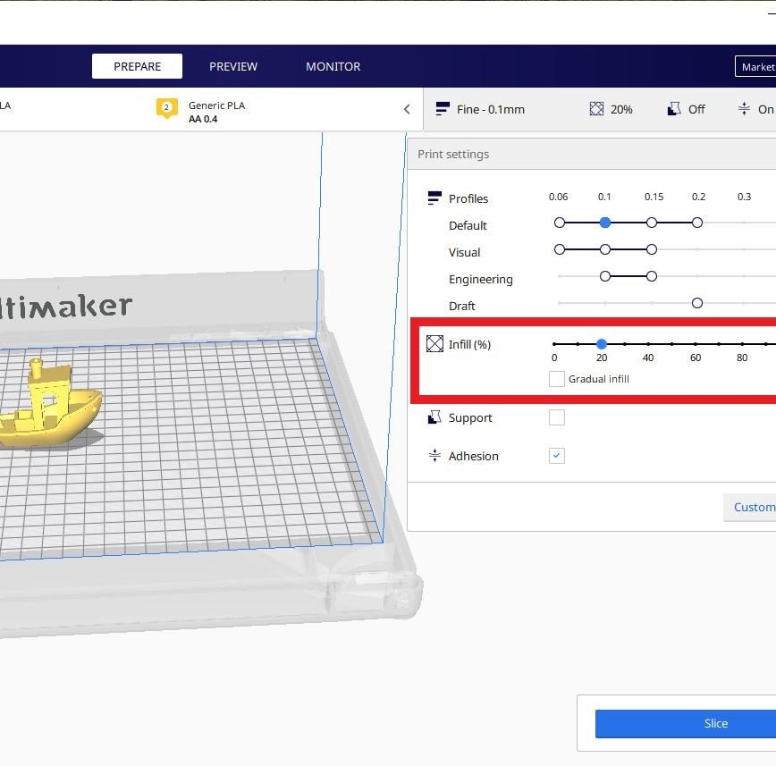

*Lab 7 reference — target model / setting*

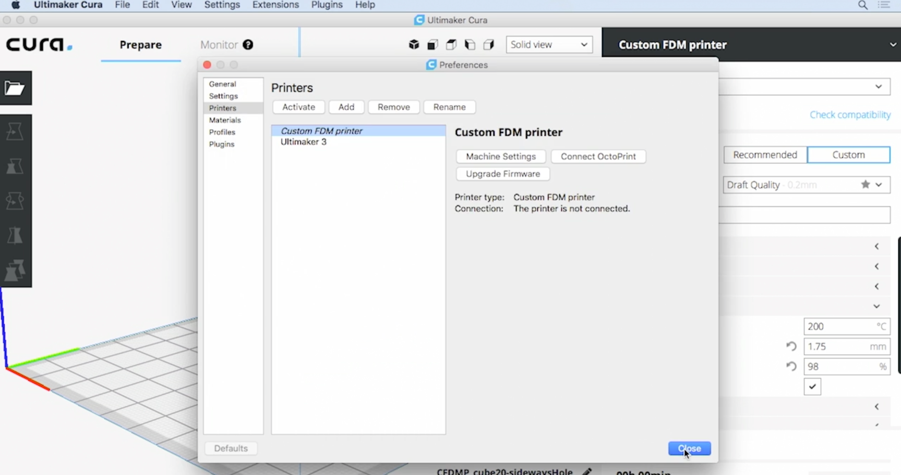

*Lab 7 reference — as prepared in the tool*

**Step-by-step**

1. Download Ultimaker Cura for your operating system and run the installer.

   ```
   https://ultimaker.com/software/ultimaker-cura
   ```

2. Launch Cura and step through the first-run wizard; skip account sign-in if offered.

   ```
   Cura ▸ Get Started
   ```

3. Add your printer — pick the exact model, or 'Custom FFF printer' with your bed size and nozzle diameter.

   ```
   Settings ▸ Printer ▸ Add Printer
   ```

4. Open the sample cube from the lab folder.

   ```
   File ▸ Open File(s) ▸ cube10.stl
   ```

5. Select the Standard Quality 0.2 mm profile and note the default wall, infill, speed and temperature values.

   ```
   Print Settings ▸ Profile — Standard Quality 0.2 mm
   ```

6. Slice the model and read the estimated print time and material use.

   ```
   Slice ▸ note time + grams
   ```

7. Open the Preview tab and drag the layer slider to watch the toolpath layer by layer — walls, infill, travels.

   ```
   Preview ▸ layer slider
   ```

8. Save the G-code to disk (or SD card) — this file is the printer's complete instruction set.

   ```
   Save to Disk ▸ cube10.gcode
   ```

9. Repeat the slice with cube20.stl, confirm Cura reads it as 20 × 20 × 20 mm, and compare the time/material estimate with cube10.stl.

   ```
   File ▸ Open File(s) ▸ cube20.stl ▸ Scale ▸ verify 20 mm on X/Y/Z
   ```


**Evidence to capture**

- Screenshot of cube20.stl in Cura Preview with walls, infill and travel moves visible.
- Recorded print-time and material estimates for both the 10 mm and 20 mm cubes.

**Test it**

Cura shows per-layer toolpaths for both cubes, cube20.stl measures 20 × 20 × 20 mm, and your comparison explains why doubling linear size increases print time and material by much more than two times.

> **Note:** This lab lives in labs/lab-07-install-cura-and-slice/ together with any sample files it needs.

---


### Lab 8 — Bed Adhesion — Skirt vs Brim vs Raft

TSC objective: A2 — analyse first-layer adhesion issues and select the correct adhesion aid.

Goal: Slice three instances of the same cube with a skirt, a brim and a raft, print them, and compare adhesion strength, removal effort and bottom-surface finish.

**What you'll build**

Three prints of cube10.stl demonstrating skirt, brim and raft — and a rule for when to use each.   (Tools: Ultimaker Cura, cube10.stl, FDM printer.)

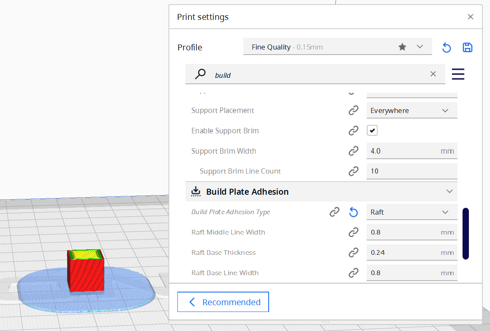

*Lab 8 reference — target model / setting*

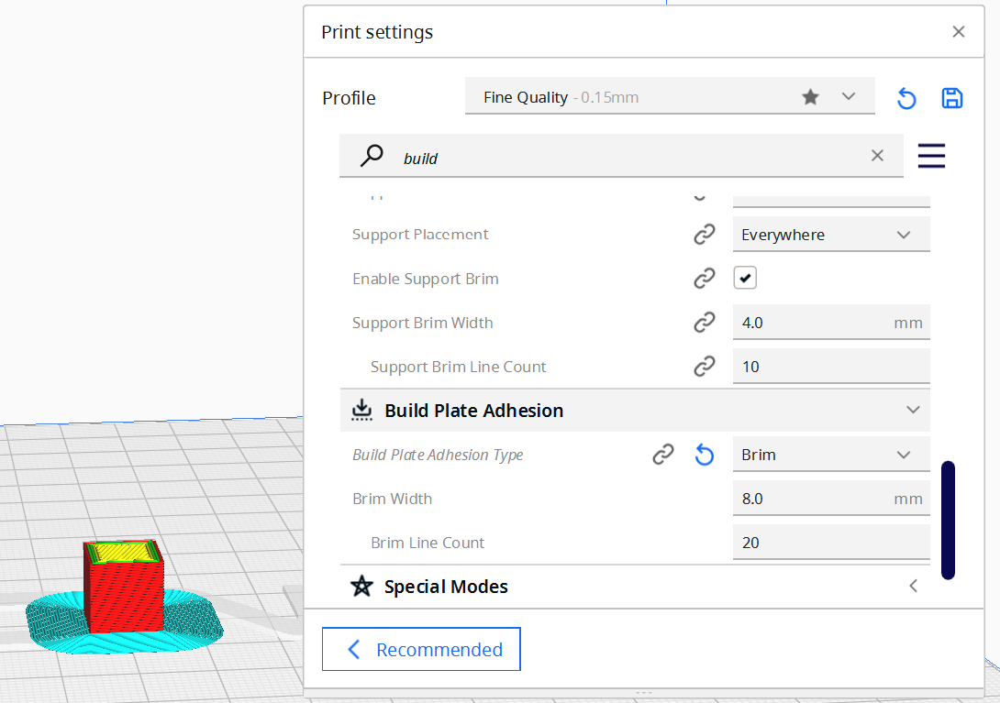

*Lab 8 reference — as prepared in the tool*

**Step-by-step**

1. Open cube10.stl in Cura and duplicate it twice so three cubes sit on the plate.

   ```
   Right-click ▸ Multiply Selected — 2 copies
   ```

2. Select cube 1 and set Build Plate Adhesion to Skirt — a loop that primes the nozzle without touching the part.

   ```
   Per Model Settings ▸ Build Plate Adhesion ▸ Skirt
   ```

3. Select cube 2 and set adhesion to Brim, 8 mm — a flat border fused to the part's first layer.

   ```
   Build Plate Adhesion ▸ Brim — width 8 mm
   ```

4. Select cube 3 and set adhesion to Raft — a printed platform the part sits on.

   ```
   Build Plate Adhesion ▸ Raft
   ```

5. Slice and compare the three toolpaths in Preview; note the extra time and material the raft adds.

   ```
   Slice ▸ Preview
   ```

6. Print all three cubes in one job.

   ```
   Save to Disk ▸ print
   ```

7. Remove each cube: note how the skirt never touches, the brim peels off the edge, and the raft must be pried from the base.

   ```
   Deburring tool / scraper
   ```


**Evidence to capture**

- Cura Preview screenshot showing the skirt, 8 mm brim and raft toolpaths.
- Recorded time/material estimate for each adhesion option.
- Photo or observation table comparing removal effort and bottom-surface finish.

**Test it**

You can state when each aid applies — skirt to prime the nozzle, brim for warping-prone or small-footprint parts, raft for top-heavy or poorly adhering parts — and show the bottom-finish difference.

> **Note:** This lab lives in labs/lab-08-bed-adhesion-skirt-vs/ together with any sample files it needs.

---


### Lab 9 — Support Structures for Overhangs

TSC objective: A2, A3 — determine when overhang geometry requires supports and generate them.

Goal: Use supplied twist, wedge and sideways-hole models to identify unsupported islands, compare orientation choices, then generate only the supports the geometry needs.

**What you'll build**

A support decision sheet plus a printed Twisted Solid whose critical overhangs succeed with controlled support use.   (Tools: Ultimaker Cura, Twisted-Solid.stl, wedge.stl, cube20-sideways-hole.stl, FDM printer.)

**Supplied model files**

- Twisted-Solid.stl — 49 mm twisted benchmark with steep faces and changing overhangs.
- wedge.stl — Simple 60 mm overhang-angle benchmark for reading progressive underside quality.
- cube20-sideways-hole.stl — Sideways-hole benchmark for comparing support, bridging and reorientation.

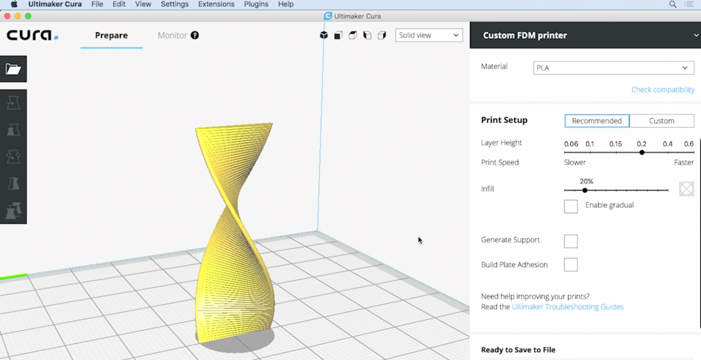

*Lab 9 reference — target model / setting*

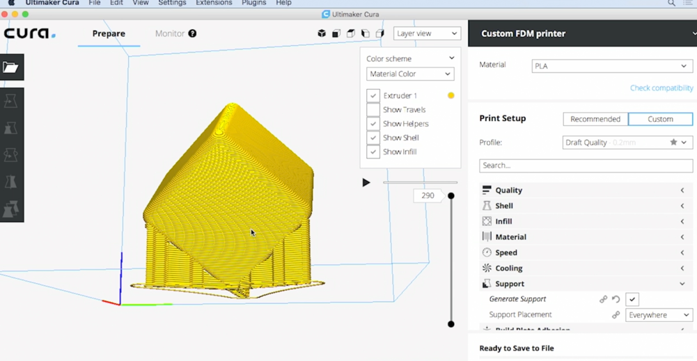

*Lab 9 reference — as prepared in the tool*

**Step-by-step**

1. Open Twisted-Solid.stl in Cura and slice it with supports off.

   ```
   File ▸ Open ▸ Twisted-Solid.stl ▸ Slice
   ```

2. In Preview, find the layers that start in mid-air — these overhangs would droop or fail.

   ```
   Preview ▸ layer slider — spot unsupported islands
   ```

3. Enable support generation.

   ```
   Print Settings ▸ Support ▸ Generate Support ✔
   ```

4. Set placement to Touching Buildplate first; compare with Everywhere and note the difference in Preview.

   ```
   Support Placement — Touching Buildplate vs Everywhere
   ```

5. Keep the support overhang angle at 45–50° so only genuinely steep faces get support.

   ```
   Support Overhang Angle — 50°
   ```

6. Slice again and compare time and material with the unsupported version, then print.

   ```
   Slice ▸ Save to Disk ▸ print
   ```

7. Snap the supports off with pliers, working from the edges inward, and inspect the supported surfaces.

   ```
   Needle-nose pliers ▸ remove supports
   ```

8. Repeat the analysis with wedge.stl and cube20-sideways-hole.stl; for each, compare adding support with rotating the model to make the geometry self-supporting.

   ```
   Open both models ▸ Rotate ▸ Slice ▸ Preview ▸ record decision
   ```


**Evidence to capture**

- Three-model support decision table: risk, best orientation, support placement and reason.
- Before/after Cura Preview screenshots for Twisted-Solid.stl with supports off and on.
- Photo of the printed benchmark after support removal, with scarring annotated.

**Test it**

Your decision table correctly identifies unsupported islands and distinguishes when support is necessary from when reorientation is the better fix; the Twisted Solid print completes with removable support and only minor underside scarring.

> **Note:** This lab lives in labs/lab-09-support-structures-for-overhangs/ together with any sample files it needs.

---


### Lab 10 — Filament Diagnostics — Diameter, Temperature and Flow

TSC objective: A2, A3 — analyse material-side causes of extrusion issues and verify filament quality.

Goal: Measure filament diameter with digital calipers, verify it against the slicer's material setting, and run a temperature check to place your filament in its working window.

**What you'll build**

A verified filament profile plus retraction and cooling evidence from purpose-built diagnostic models.   (Tools: Digital calipers, filament spool (PLA/ABS/PETG), Ultimaker Cura, retraction-test.stl, cooling-spire.stl, FDM printer.)

**Supplied model files**

- retraction-test.stl — Multi-tower benchmark that exposes stringing during travel moves.
- cooling-spire.stl — Tall narrowing spire that reveals insufficient layer cooling.
- twist-with-cooling-tower.stl — Combined geometry for observing minimum-layer-time and cooling behaviour.

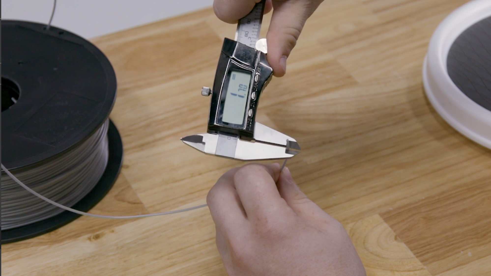

*Lab 10 reference — target model / setting*

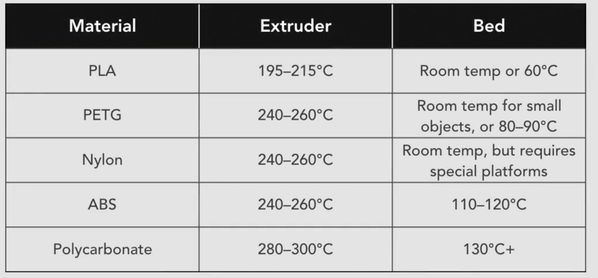

*Lab 10 reference — as prepared in the tool*

**Step-by-step**

1. Cut off about 30 cm of filament from the spool end.

   ```
   Flush cutters — ~30 cm sample
   ```

2. Measure the diameter with digital calipers at five points along the sample, rotating the filament at each point.

   ```
   Calipers — 5 readings, 2 orientations each
   ```

3. Average the readings; a good 1.75 mm filament stays within ±0.05 mm.

   ```
   Expect 1.70–1.80 mm
   ```

4. Enter the measured diameter in Cura's material settings so flow is computed from reality, not the label.

   ```
   Print Settings ▸ Material ▸ Diameter — measured value
   ```

5. Check the material's temperature window: PLA 195–215 °C, PETG 240–260 °C, ABS 240–260 °C, Nylon 240–260 °C.

   ```
   Material box / temperature table
   ```

6. Set the printing temperature to the middle of the window and print a small test cube; drop 5 °C if strings appear, raise 5 °C if layers don't bond.

   ```
   Material ▸ Printing Temperature — tune in 5 °C steps
   ```

7. Watch the first layers: clicking from the extruder or ground filament means the temperature is too low or the nozzle is partially blocked.

   ```
   Listen: extruder clicks = under-extrusion warning
   ```

8. Slice retraction-test.stl with your baseline retraction, then change only one variable at a time (distance or speed); compare strings without masking jams or surface dimples.

   ```
   Retraction ▸ record distance + speed ▸ Preview ▸ optional test print
   ```

9. Slice cooling-spire.stl or twist-with-cooling-tower.stl and compare the upper layers with minimum layer time/fan control enabled and disabled.

   ```
   Cooling ▸ Enable Print Cooling ▸ Minimum Layer Time ▸ compare tip quality
   ```


**Evidence to capture**

- Five filament-diameter readings and the calculated average.
- Retraction matrix recording distance, speed, stringing and surface defects.
- Cooling comparison recording fan/minimum-layer-time settings and tip quality.

**Test it**

Your diameter average is within ±0.05 mm of nominal, Cura carries the measured value, and the diagnostic models support a retraction/cooling choice with less stringing and a cleaner spire without introducing gaps or jams.

> **Note:** This lab lives in labs/lab-10-filament-diagnostics-diameter-temperature/ together with any sample files it needs.

---


## Topic 03 — Process Improvement for AM

Infill · surface quality · supports · post-processing · business impact  (K5, K7 · A5, A6)

**Key concepts**

- Infill optimisation — Perimeters, infill pattern and density trade strength against material use and print time.
- Surface quality — Layer height, top thickness, ironing and fuzzy skin control the finish and the print duration.
- Support strategy — Orient parts to minimise supports; add them only where overhangs demand, and plan their removal.
- Post-processing — FDM, SLS, SLA and metal parts each have a defined finishing chain — from support removal to plating.
- Business impact — Measure speed, quality, material use, cost and user feedback before and after every process change.
- Sustainability — Calibration, training, sustainable materials and stakeholder collaboration keep AM operations viable long-term.


### Lab 11 — Perimeters and Infill — Strength vs Speed

TSC objective: A5, A6 — apply wall/infill optimisation and assess its measured impact on time and material.

Goal: Vary wall count and infill density on the same model in Cura, and record how each change moves print time, material use and expected strength.

**What you'll build**

A comparison table of wall/infill settings against sliced print time and material grams.   (Tools: Ultimaker Cura, cube10.stl, line-width-test.stl, cube20 hole-wall variants.)

**Supplied model files**

- line-width-test.stl — Thin-wall benchmark for nozzle/line-width and single-wall behaviour.
- cube20-hole-0-wall.stl — Hole benchmark with the wall-control baseline geometry.
- cube20-hole-1-wall.stl — Matched hole benchmark for testing the effect of an additional wall.

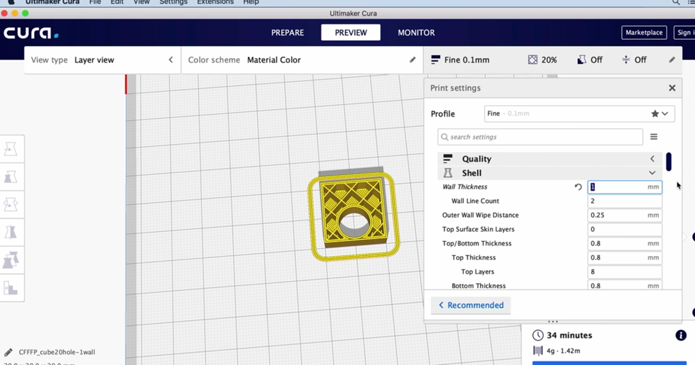

*Lab 11 reference — target model / setting*

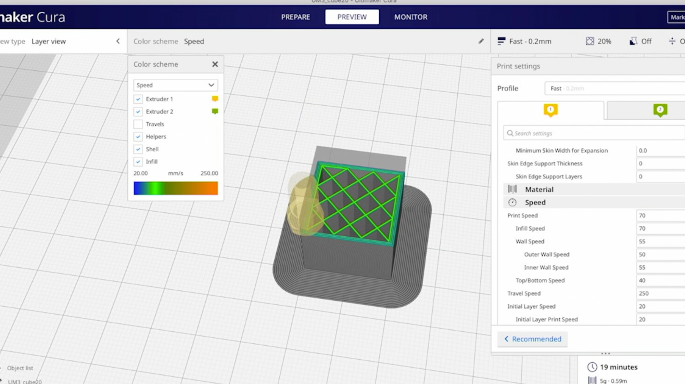

*Lab 11 reference — as prepared in the tool*

**Step-by-step**

1. Open cube10.stl and slice with the defaults — 2 walls, 20% infill; record time and grams.

   ```
   Slice ▸ record: baseline
   ```

2. Raise the wall line count to 4 and re-slice; record the change.

   ```
   Print Settings ▸ Walls ▸ Wall Line Count — 4
   ```

3. Reset walls to 2, then set infill density to 12% and re-slice; record.

   ```
   Infill ▸ Density — 12%
   ```

4. Set infill density to 50% and re-slice; record.

   ```
   Infill ▸ Density — 50%
   ```

5. In Preview, inspect how the infill lattice and wall thickness change at each setting.

   ```
   Preview ▸ layer slider
   ```

6. Tabulate the four runs: time, grams, and where the strength actually comes from (walls more than infill).

   ```
   Table: setting → time → grams
   ```

7. Open line-width-test.stl and the two cube20 hole-wall variants; inspect Preview for missing thin features, then record the smallest feature and hole wall your profile resolves continuously.

   ```
   Open three diagnostic models ▸ Preview ▸ Color Scheme: Line Type
   ```


**Evidence to capture**

- Wall/infill table with time, material and expected load-path notes.
- Cura Preview comparison of the line-width and matched hole-wall models.
- Measured hole diameter and wall thickness from any printed benchmark.

**Test it**

Your evidence separates wall-count, infill and line-width effects; the matched hole models show how wall planning changes continuity and dimensional accuracy, and you can justify settings for functional versus decorative parts.

> **Note:** This lab lives in labs/lab-11-perimeters-and-infill-strength/ together with any sample files it needs.

---


### Lab 12 — Infill Patterns — Zigzag vs Grid Strength Test

TSC objective: A5 — evaluate infill pattern and density as a quality-improvement technique.

Goal: Print cube10.stl with zigzag 20% and grid 30% infill, tune the top layers, then compare the two cubes' stiffness by hand.

**What you'll build**

Two printed cubes with different infill patterns/densities and a hands-on strength comparison.   (Tools: Ultimaker Cura, cube10.stl, Optimize1–4 model set, FDM printer.)

**Supplied model files**

- optimize-1.stl — Complex baseline part for printability and support-cost review.
- optimize-2.stl — Wide low-profile variant for build-orientation comparison.
- optimize-3.stl — Twisted variant for support and toolpath comparison.
- optimize-4.stl — Compact variant for rapid slicing and material-use comparison.

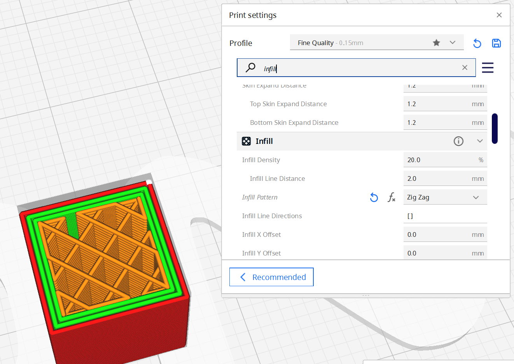

*Lab 12 reference — target model / setting*

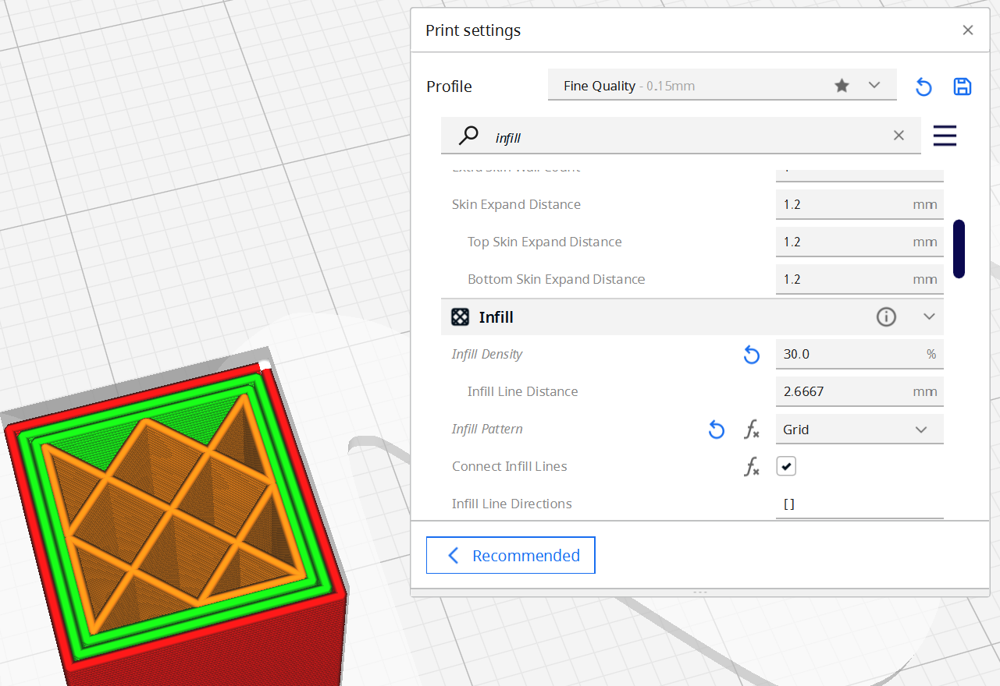

*Lab 12 reference — as prepared in the tool*

**Step-by-step**

1. Open cube10.stl and set infill pattern to Zigzag at 20% density.

   ```
   Infill ▸ Pattern — Zigzag, Density — 20%
   ```

2. Set top layers to 4 so the roof closes cleanly over the infill.

   ```
   Top/Bottom ▸ Top Layers — 4
   ```

3. Slice, save and print the first cube.

   ```
   Slice ▸ Save to Disk ▸ print
   ```

4. Change the pattern to Grid at 30% density and re-slice; note the time difference.

   ```
   Infill ▸ Pattern — Grid, Density — 30%
   ```

5. Print the second cube.

   ```
   Save to Disk ▸ print
   ```

6. Compare the cubes: squeeze the walls, press the top faces, and note pillowing or gaps over the infill.

   ```
   Hand test: wall flex + roof sag
   ```

7. Load optimize-1.stl through optimize-4.stl, orient each for minimum support, and record Cura's estimated time/material before choosing the most efficient printable variant.

   ```
   Open four models ▸ Auto Orient/Rotate ▸ Slice ▸ record estimates
   ```


**Evidence to capture**

- Optimisation scorecard for all four supplied variants: orientation, support volume, time and material.
- A justified selection of the best variant/settings for the stated business need.

**Test it**

The grid 30% cube is stiffer and better supported, while your four-variant scorecard shows that geometry and orientation can outweigh infill choice; your final recommendation is backed by time, material and support evidence.

> **Note:** This lab lives in labs/lab-12-infill-patterns-zigzag-vs/ together with any sample files it needs.

---


### Lab 13 — Layer Height and Top Thickness — Surface Quality

TSC objective: A5 — optimise layer height and top thickness for surface quality vs speed.

Goal: Slice the same model at 0.1 mm, 0.2 mm and 0.3 mm layer heights, adjust top thickness to a constant, and compare surface quality against print time.

**What you'll build**

Sliced (and optionally printed) evidence of the layer-height ladder: finish vs time.   (Tools: Ultimaker Cura, cube10.stl, sloped-cube.stl, FDM printer.)

**Supplied model files**

- sloped-cube.stl — Sloped-face benchmark that makes layer-height stair-stepping easy to compare.

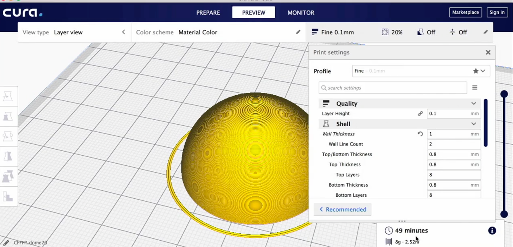

*Lab 13 reference — target model / setting*

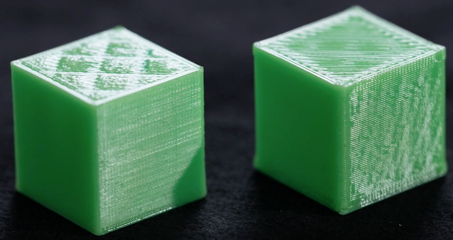

*Lab 13 reference — as prepared in the tool*

**Step-by-step**

1. Open cube10.stl and slice at 0.2 mm layer height; record the time.

   ```
   Quality ▸ Layer Height — 0.2 mm
   ```

2. Slice at 0.1 mm; note the doubled layer count and time.

   ```
   Layer Height — 0.1 mm
   ```

3. Slice at 0.3 mm; note the coarser stairs and the reduced time.

   ```
   Layer Height — 0.3 mm
   ```

4. Keep top thickness constant at 0.8 mm — so the TOP LAYER COUNT changes with layer height (8 / 4 / 3 layers).

   ```
   Top/Bottom ▸ Top Thickness — 0.8 mm
   ```

5. In Preview, compare side-wall stair-stepping and the roof at each height.

   ```
   Preview ▸ compare walls + roof
   ```

6. Print the 0.1 mm and 0.3 mm cubes and compare finish by eye and touch.

   ```
   print both
   ```

7. Repeat the three slices with sloped-cube.stl and zoom into the sloped face; this geometry makes the staircase effect visible in Preview before printing.

   ```
   Open sloped-cube.stl ▸ Slice at 0.1 / 0.2 / 0.3 mm ▸ compare
   ```


**Evidence to capture**

- Three-row layer-height table with layer count, print time and observed stair-stepping.
- Matched Preview screenshots of the sloped face at 0.1, 0.2 and 0.3 mm.

**Test it**

You can rank the layer heights by finish and time, point to visible stair-stepping on sloped-cube.stl, and explain why constant top thickness—not a fixed top-layer count—keeps the comparison fair.

> **Note:** This lab lives in labs/lab-13-layer-height-and-top/ together with any sample files it needs.

---


### Lab 14 — Ironing — Glass-Smooth Top Surfaces

TSC objective: A5 — apply ironing to improve top-surface quality and assess its cost.

Goal: Enable Cura's ironing feature, which passes the hot nozzle over the top surface with a tiny extrusion, and compare the top finish with and without it.

**What you'll build**

Two cube prints — ironed and standard — demonstrating the top-surface improvement.   (Tools: Ultimaker Cura, cube10.stl, z-block.stl, FDM printer.)

**Supplied model files**

- z-block.stl — Detailed top-surface benchmark for evaluating ironing around raised geometry.

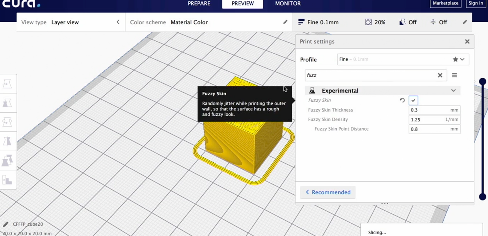

*Lab 14 reference — target model / setting*

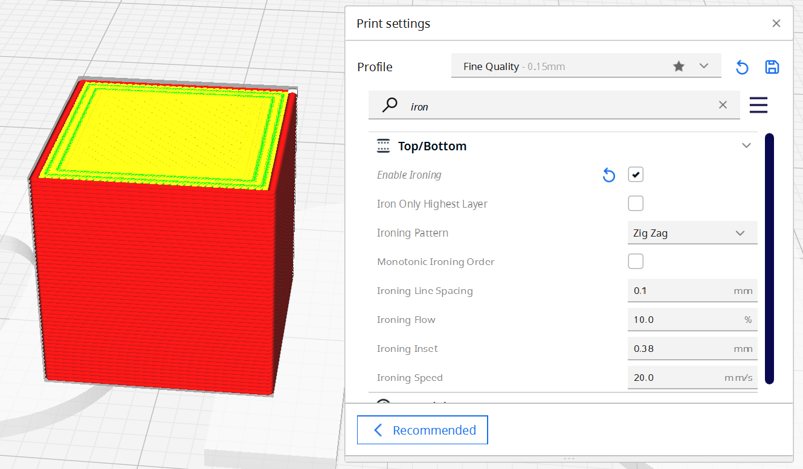

*Lab 14 reference — as prepared in the tool*

**Step-by-step**

1. Open cube10.stl and slice with the standard 0.2 mm profile; print cube 1 as the control.

   ```
   Slice ▸ print control cube
   ```

2. Enable ironing.

   ```
   Top/Bottom ▸ Enable Ironing ✔
   ```

3. Inspect the ironing pass in Preview — a dense zigzag over the top face at ~10% flow.

   ```
   Preview ▸ top layer ▸ ironing pass
   ```

4. Slice and note the added time (ironing is slow but only on top faces).

   ```
   Slice ▸ record extra minutes
   ```

5. Print cube 2 with ironing enabled.

   ```
   Save to Disk ▸ print
   ```

6. Compare the two top faces under raking light: the ironed face should be near-flat with faint tool lines.

   ```
   Visual + touch comparison
   ```

7. Repeat the Preview comparison with z-block.stl to inspect how ironing travels around raised detail; print it only if time permits.

   ```
   Open z-block.stl ▸ Enable Ironing ▸ Preview top layers
   ```


**Evidence to capture**

- Control-versus-ironed time/material record.
- Raking-light photos comparing the flat and detailed top surfaces.

**Test it**

The ironed cube is visibly smoother than the control, z-block.stl shows ironing constrained to eligible top faces, and you can justify the added time for lids, logos and presentation surfaces.

> **Note:** This lab lives in labs/lab-14-ironing-glass-smooth-top/ together with any sample files it needs.

---


### Lab 15 — Fuzzy Skin — Textured Walls on a Vase

TSC objective: A5 — apply fuzzy skin as a deliberate surface-texture treatment.

Goal: Enable fuzzy skin on a vase model so the outer wall is jittered into a stone-like texture that hides layer lines, and print it with buildplate adhesion.

**What you'll build**

A vase with a uniform fuzzy texture that masks layer lines completely.   (Tools: Ultimaker Cura, open vase.stl, 1.5mm-wall-vase.stl, FDM printer.)

**Supplied model files**

- 1.5mm-wall-vase.stl — Thin-walled vase benchmark for comparing fuzzy skin with wall-thickness constraints.

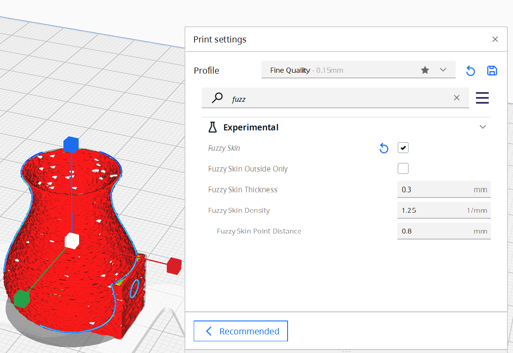

*Lab 15 reference — target model / setting*

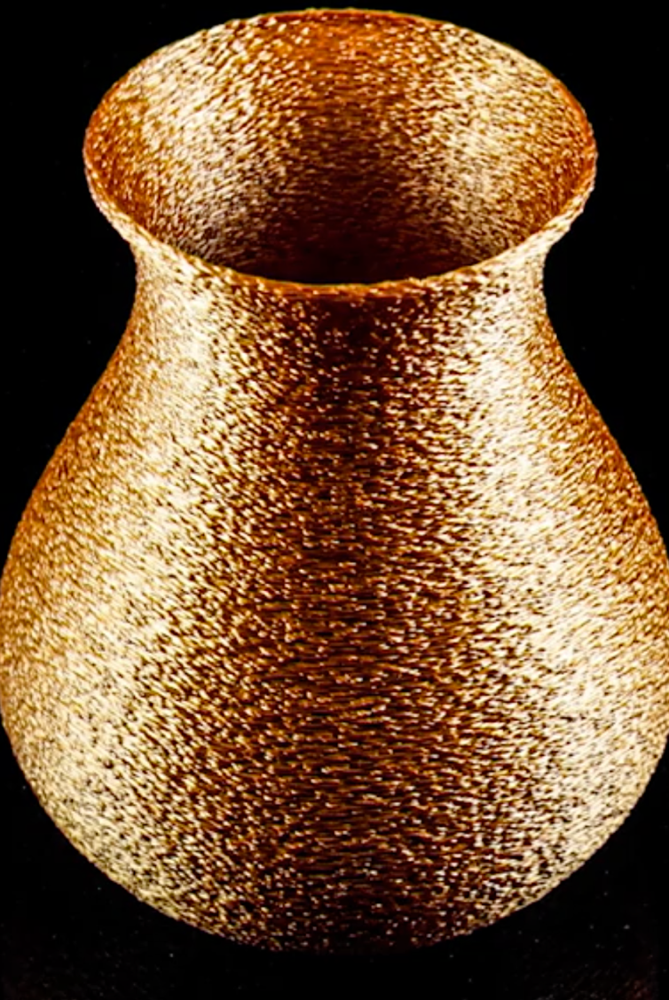

*Lab 15 reference — as prepared in the tool*

**Step-by-step**

1. Open 'open vase.stl' in Cura.

   ```
   File ▸ Open ▸ open vase.stl
   ```

2. Enable fuzzy skin — the slicer adds random jitter to the outer wall toolpath.

   ```
   Experimental ▸ Fuzzy Skin ✔
   ```

3. Set fuzzy skin thickness to 0.3 mm and density to 1.25/mm for a fine stone texture.

   ```
   Fuzzy Skin Thickness 0.3 mm · Density 1.25
   ```

4. Add a brim so the tall thin vase stays anchored.

   ```
   Build Plate Adhesion ▸ Brim
   ```

5. Slice and inspect the jittered outer wall in Preview.

   ```
   Slice ▸ Preview ▸ outer wall
   ```

6. Print the vase and examine the texture — layer lines should be invisible within the fuzz.

   ```
   print + inspect
   ```

7. Open 1.5mm-wall-vase.stl and verify the chosen fuzzy-skin thickness will not consume the thin wall; reduce the effect if Preview shows unstable or missing wall paths.

   ```
   Open 1.5mm-wall-vase.stl ▸ Preview ▸ Line Type ▸ inspect wall continuity
   ```


**Evidence to capture**

- Cura Preview showing fuzzy-skin jitter and the 1.5 mm wall toolpaths.
- Close-up photo and tactile assessment of the finished texture.

**Test it**

The printed vase carries an even tactile texture, and the 1.5 mm diagnostic vase retains continuous walls in Preview—showing that the texture setting fits the available wall thickness.

> **Note:** This lab lives in labs/lab-15-fuzzy-skin-textured-walls/ together with any sample files it needs.

---


### Lab 16 — Post-Processing — Support Removal and Sanding

TSC objective: A5 — apply post-processing to lift the quality of an FDM part.

Goal: Print the vase tilted so it needs supports, remove them cleanly, then sand the scarred surfaces through progressive grits to a smooth finish.

**What you'll build**

A tilted-print vase taken from raw support-scarred print to a smooth finished part.   (Tools: Ultimaker Cura, open vase.stl, test-part.stl, FDM printer, pliers, sandpaper 120→400 grit.)

**Supplied model files**

- test-part.stl — Mixed-feature benchmark for planning support removal and progressive finishing.

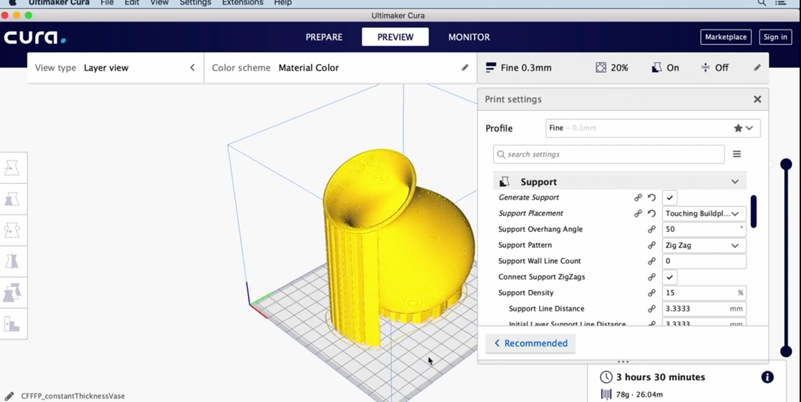

*Lab 16 reference — target model / setting*

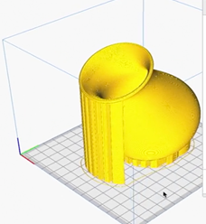

*Lab 16 reference — as prepared in the tool*

**Step-by-step**

1. Open 'open vase.stl' in Cura and rotate it 15–20° off vertical so one side overhangs.

   ```
   Rotate — 15–20° tilt
   ```

2. Enable supports (Touching Buildplate) and slice.

   ```
   Support ▸ Generate ✔ ▸ Touching Buildplate
   ```

3. Print the tilted vase with its supports.

   ```
   Save to Disk ▸ print
   ```

4. Snap the supports off with pliers, working from the outer edge toward the part.

   ```
   Needle-nose pliers
   ```

5. Sand the support-scarred areas with 120-grit, then step through 240 → 400 grit in circular motions.

   ```
   Sandpaper 120 → 240 → 400
   ```

6. Optionally wet-sand at 400 grit for a satin finish, and compare the treated side with an untouched area.

   ```
   Wet sand + compare
   ```

7. Inspect test-part.stl in Cura and write a finishing plan before printing: support access, tool order, surfaces to protect and dimensions that sanding must not change.

   ```
   Open test-part.stl ▸ Preview supports ▸ annotate finishing plan
   ```


**Evidence to capture**

- Annotated before/after photographs of support scars and the sanded surface.
- Finishing log with tools, grit sequence, time and observed dimensional/detail loss.

**Test it**

The support side is smooth from a normal viewing distance, and your evidence shows a planned 120→240→400 grit process that removes scars without rounding protected features or critical dimensions.

> **Note:** This lab lives in labs/lab-16-post-processing-support-removal/ together with any sample files it needs.

---


## Revision — What to Master for the Assessment

**Knowledge (Written Assessment, K1–K7)**

- K1 — AM characteristics: layer-by-layer construction from CAD, design freedom, rapid prototyping, no part-specific tooling; the 7 ISO/ASTM process families and DMLS/SLS/SLM.
- K2 — Process requirements: correct material choice (PLA/ABS/PETG/Nylon/resins), temperature windows, build environment (draughts, humidity, vibration), calibrated and maintained printers.
- K3 — Selection factors: material properties, design complexity, production volume and speed, post-processing needs, cost.
- K4 — Impact on operations: no tooling/molds, shorter development cycles, complex geometry, customisation without cost, less waste, distributed manufacturing.
- K5 — Performance review methods: dimensional accuracy and tolerance checks, surface-finish evaluation, material property tests, build speed/throughput, cost per part.
- K6 — Benefits vs trade-offs: rapid prototyping, design flexibility, low waste, customisation — against bulk-production cost, material limits, post-processing load, anisotropic strength.
- K7 — Sustainability: operator training, equipment calibration/maintenance, recycling and circular material use, sustainable-material R&D, stakeholder collaboration on standards.

**Application (Practical Performance, A1–A6)**

- A1 — Material and design analysis: mechanical/thermal properties, stress points, load-bearing needs, AM-process compatibility, post-processing and surface treatments.
- A2 — Process issues: DMLS warping/powder inconsistency; SLS incomplete sintering/thermal distortion; SLM oxidation/residual stress; powder-bed spreading and recycling; inkjet nozzle clogs and layer misalignment.
- A3 — Processes and procedures: DMLS/SLM for metals, FDM/SLS for non-metals, separate post-processing per material, bonding techniques (e.g. electroless deposition) for hybrid parts, integrity testing.
- A4 — Reverse engineering: scan → refine mesh to CAD → repair wear digitally → select AM process → manufacture and post-process.
- A5 — Optimisation: layer height/orientation, walls/infill tuning, machine calibration, support optimisation, surface treatments (ironing, fuzzy skin), real-time monitoring and simulation.
- A6 — Impact assessment: baseline → change → measure → compare → decide, across production speed, material use/wastage, quality (accuracy, finish, properties), resource utilisation, cost and operator feedback.

**Practice**

- Course portal (slides, guide, assessment submission): https://lms-tms.tertiaryinfotech.com
- Redo each lab's Test-it check from memory — the practical assessment mirrors the lab skills.
- Use the supplied diagnostic STL files to explain what each geometry reveals before changing a slicer setting.


## Glossary

- **Additive Manufacturing (AM)** — Building parts layer by layer directly from a CAD file — the industrial discipline around 3D printing.
- **STL** — The mesh file format (triangles) exported from CAD and consumed by slicers.
- **G-code** — The movement/temperature/extrusion command language slicers output and printers execute.
- **Slicer** — Software (e.g. Cura) that converts a 3D model into layer-by-layer printer instructions.
- **FDM/FFF** — Fused Deposition Modeling — melted filament extruded layer by layer; the desktop standard.
- **SLA / DLP / LCD** — Vat photopolymerisation — light selectively cures liquid resin.
- **SLS** — Selective Laser Sintering — a laser fuses polymer powder, no supports needed.
- **DMLS / SLM** — Metal powder bed fusion — sintered (DMLS) vs fully melted (SLM).
- **DED** — Directed Energy Deposition — blown powder or wire melted in place; repair and large parts.
- **Infill** — The internal lattice of a print — pattern and density trade strength for time/material.
- **Perimeter / wall** — The solid outline of each layer; walls carry most of a part's strength.
- **Raft / brim / skirt** — First-layer adhesion aids: platform under the part / border fused to its edge / non-touching priming loop.
- **Retraction** — Pulling filament back during travel moves to stop oozing and stringing.
- **Heat creep** — Heat spreading up the filament path causing jams before the melt zone.
- **Pillowing** — Top-surface sagging/curling over sparse infill on thin roofs.
- **Ironing** — A near-zero-flow hot pass that smooths top surfaces.
- **Fuzzy skin** — Deliberate jitter on outer walls that hides layer lines behind texture.
- **Reverse engineering** — Capturing an existing part (3D scanning) and rebuilding it as editable CAD for re-manufacture.
- **Photogrammetry** — Reconstructing 3D geometry from many overlapping photographs.
- **Post-processing** — Everything after the build: support removal, curing, heat treatment, machining, finishing.
